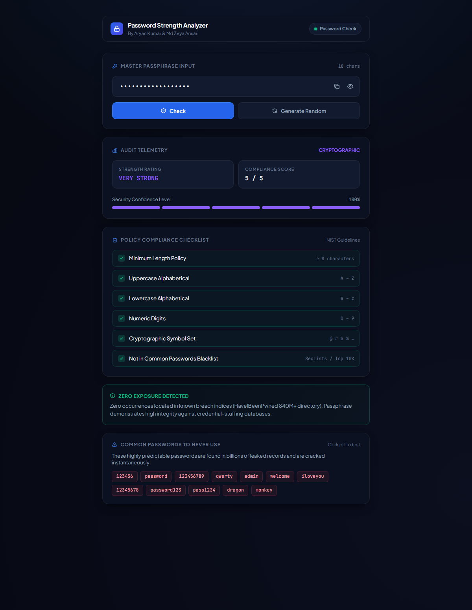
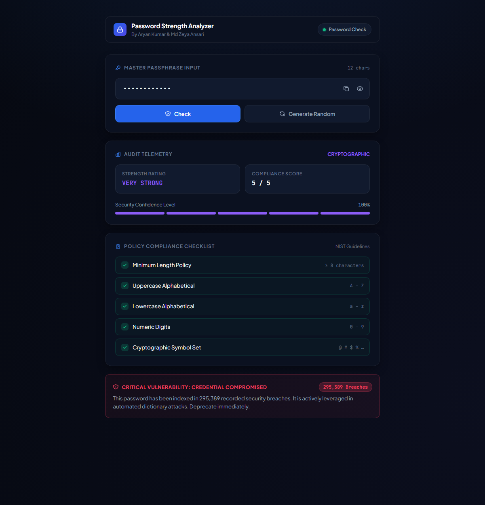
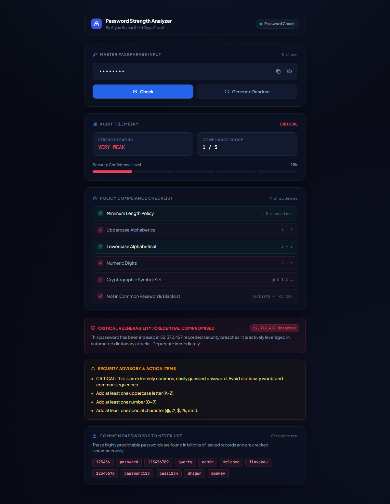

# 🔐 Password Strength Analyzer

A real-time **Password Strength Analyzer** built with **Python** and **Flask**, featuring an executive cybersecurity dashboard that evaluates entropy, NIST compliance, and breach exposures as you type.

---

## ✨ Features

- ⚡ **On-Demand Cryptographic Audit** — evaluates security confidence and policy compliance via the **Check** button or **Enter** key
- 🚫 **Common Passwords Blacklist** — detects & penalizes highly predictable dictionary passwords (e.g. `123456`, `password`, `qwerty`, `admin`, `welcome`)
- 📊 **Segmented Security Meter** — enterprise-grade visual confidence indicators
- 📋 **NIST Policy Compliance Checklist** — verified against length, case sensitivity, numbers, symbols, and blacklist checks
- 🚨 **Zero-Knowledge Breach Surveillance** — cross-references Have I Been Pwned API (k-anonymity SHA-1 prefix lookup; plaintext never leaves the client)
- 📋 **One-Click Copy & Masking** — clipboard utility with instant feedback and visibility toggle
- 🛡️ **Executive Dashboard UI** — obsidian dark slate design with precision typography and micro-interactions

---

## 🚫 Common Passwords to Never Use

These passwords account for the vast majority of credential-stuffing and automated dictionary attacks:

| Rank | Password | Vulnerability Type |
|:---:|:---|:---|
| 1 | `123456` | Trivial sequential numeric |
| 2 | `password` | Dictionary word |
| 3 | `123456789` | Sequential numeric |
| 4 | `qwerty` | Keyboard row sequence |
| 5 | `admin` | Default administrative credential |
| 6 | `welcome` | Common default phrase |
| 7 | `iloveyou` | High-frequency cultural phrase |
| 8 | `12345678` | Sequential numeric |
| 9 | `password123` | Dictionary word + simple sequence |
| 10 | `pass1234` | Predictable permutation |

---

## 📸 Feature & Test Previews

### 1. Strong Password · Zero Exposure Detected
High-entropy passphrase meeting all NIST policy criteria and verified clean against compromised credential registries:


### 2. Data Breach Detection · Compromised Credential
Detects passwords leaked in known public breaches via HaveIBeenPwned k-anonymity SHA-1 lookup:


### 3. Weak Password · Security Advisory & Remediation
Highlights failed policy criteria and generates actionable advisory items to guide the user:


---

## 🖼️ Strength Levels

| Strength     | Color      | Score |
|:-------------|:-----------|:-----:|
| VERY WEAK    | 🔴 Red     | 1 / 5 |
| WEAK         | 🟠 Orange  | 2 / 5 |
| MEDIUM       | 🟡 Yellow  | 3 / 5 |
| STRONG       | 🟢 Green   | 4 / 5 |
| VERY STRONG  | 🟣 Purple  | 5 / 5 |

---

## 📁 Project Structure

```
Password-Strength-Analyzer python/
│
├── app.py              # Flask web server & /analyze, /breach API
├── requirements.txt    # Python dependencies
├── PROJECT_REPORT.md   # Comprehensive academic project report
│
├── Screenshots/        # Application captures & test scenario states
│   ├── screenshot_clean.png
│   ├── screenshot_breached.png
│   └── screenshot_weak.png
│
└── templates/
    └── index.html      # Enterprise Security Audit Dashboard
```

---

## 🛠️ Tech Stack

| Layer     | Technology                    |
|:----------|:------------------------------|
| Backend   | Python 3, Flask               |
| Threat DB | HaveIBeenPwned Range API v3  |
| Frontend  | HTML5, CSS3, Vanilla JS       |
| API       | REST (JSON via `/analyze`, `/breach`) |

---

## 🚀 Getting Started

### Prerequisites

- Python 3.8 or higher
- pip

### 1. Clone / Download the project

```bash
git clone https://github.com/Aruack/password-strength-analyzer.git
cd "Password-Strength-Analyzer"
```

### 2. Install dependencies

```bash
pip install -r requirements.txt
```

### 3. Run the web app

```bash
python app.py
```

Open your browser and go to:

```
http://127.0.0.1:5000
```

---

## 🔍 How It Works

The analyzer checks **5 security criteria** and assigns 1 point for each:

| # | Criterion             | Requirement            |
|:-:|:----------------------|:-----------------------|
| 1 | **Length**            | At least 8 characters  |
| 2 | **Uppercase letter**  | At least one (A–Z)     |
| 3 | **Lowercase letter**  | At least one (a–z)     |
| 4 | **Number**            | At least one (0–9)     |
| 5 | **Special character** | `@`, `#`, `$`, `%`, etc. |

---

## 🌐 API Reference

### `POST /analyze`

Returns strength score, label, checklist, and suggestions as JSON.

**Request:**
```json
{ "password": "MyP@ssw0rd!" }
```

**Response:**
```json
{
  "score": 5,
  "strength": "VERY STRONG",
  "length": 10,
  "checks": {
    "length":    true,
    "uppercase": true,
    "lowercase": true,
    "digit":     true,
    "special":   true
  },
  "suggestions": []
}
```

---

### `POST /breach`

Checks the password against the **Have I Been Pwned** database using k-anonymity (only the first 5 chars of the SHA-1 hash are sent — your actual password never leaves your server).

**Request:**
```json
{ "password": "password123" }
```

**Response (leaked):**
```json
{
  "status": "leaked",
  "count": 247022,
  "message": "⚠️ This password has been found in 247,022 data breaches! Change it immediately."
}
```

**Response (safe):**
```json
{
  "status": "safe",
  "count": 0,
  "message": "✅ This password was not found in any known breach database."
}
```

---

## 📦 Dependencies

```
flask>=3.0.0
matplotlib>=3.7.0
requests>=2.31.0
```

Install:

```bash
pip install -r requirements.txt
```

---

## 👥 Contributors

| Name | GitHub |
|:-----|:-------|
| **Aryan Kumar** | [@Aruack](https://github.com/Aruack/Password-Strength-Analyzer) |
| **Md Zeya Ansari** | [@mdzeyaansari07](https://github.com/mdzeyaansari07/Password-Strength-Analyzer) |

Mini Project — Semester 1

---

## 📄 License

This project is for educational purposes.
